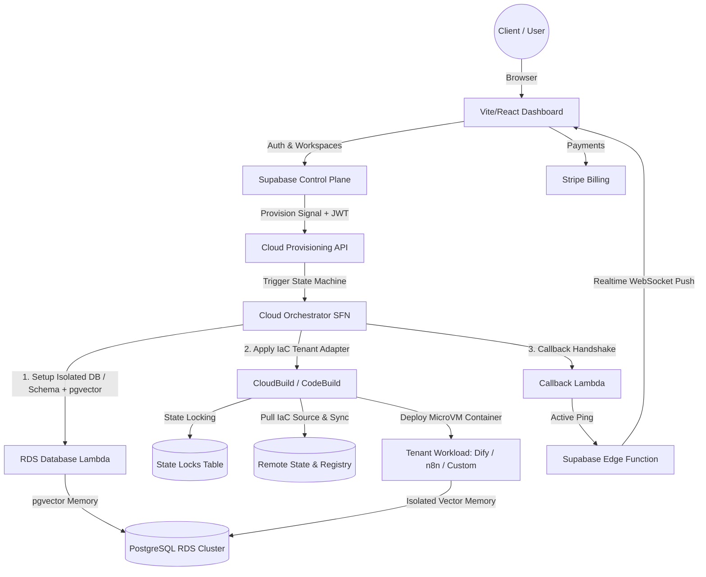

# TryBase Platform Architecture

TryBase is an open-source, multi-tenant and multi-cloud orchestration platform that deploys and manages isolated, production-grade AI Agent studios (**Dify**, **n8n**, **Langflow**) and autonomous workloads at enterprise scale.

## 1. High-Level Overview

The platform decouples into three independent, modular tiers:
1. **The Control Plane (Supabase)**: Multi-tenant authentication, organization workspaces, billing subscriptions, and real-time state streaming.
2. **The Cloud Orchestration Engine**: Serverless Infrastructure-as-Code (Terraform / OpenTofu) provisioners managing hardware-isolated microVMs and network routing (AWS Fargate / GCP Cloud Run / Azure Container Apps).
3. **The AI Workload & Vector Layer**: Containerized agent runtimes with isolated PostgreSQL memory engines (`pgvector`) and automated per-tenant encryption vaults.

---

## 2. Component Breakdown

### A. Frontend (TryBase Web)
- **Tech Stack**: Vite, React, Tailwind-style Vanilla CSS.
- **Hosting**: AWS S3 Bucket + CloudFront Distribution.
- **Features**: 
    - Glassmorphic Dashboard.
    - Real-time provisioning terminal.
    - Stripe Checkout & Customer Portal integration.

### B. Control Plane (Supabase)
- **Database**: PostgreSQL (Managed schemas for `workspaces`).
- **Edge Functions**:
    - `verify-checkout`: Validates Stripe sessions and mints workspace records.
    - `create-portal-session`: Generates secure Stripe Billing Portal links.
    - `on-provision-success`: The terminal callback from AWS to finalize workspace activation.
- **Realtime**: Used to stream status changes and "Success" events back to the Dashboard.

### C. Infrastructure Orchestration (AWS)
- **API Gateway**: Secure REST entry point using Supabase JWT Authorizers.
- **Step Functions**: The "Brain" of the deployment.
    1. **Task 1 (CodeBuild)**: Dynamically generates a Terraform `.tf` file and runs `terraform apply -target=module.tenant_id`.
    2. **Task 2 (Lambda)**: Connects to the shared RDS instance and creates a dedicated Postgres Schema for the tenant.
    3. **Task 3 (Lambda)**: Pings the Supabase Edge Function to mark the workspace as `active`.
- **ECS Fargate**: Hosts the AI agent containers. Each tenant gets a dedicated task running in an isolated AWS Firecracker MicroVM with dedicated CPU/RAM.
- **ALB (Application Load Balancer)**: Uses Host-based routing (e.g., `tenant-a.agents.trybase.io`) to forward traffic to the correct ECS service.
- **S3 & DynamoDB Backend**: S3 hosts the Terraform remote state (`shared/terraform.tfstate`), source archive (`source/infra.zip`), and tenant configurations. DynamoDB (`n8n-hosting-saas-tf-locks`) provides distributed locking and checksum verification to guarantee concurrency safety across parallel CodeBuild runs and local deployments.

### D. AI Workload & Memory Layer
- **n8n Automation Engine**: API agents and LangChain workflow nodes with isolated PostgreSQL schemas.
- **Dify Agent Studio**: Enterprise multi-agent LLM platform running on Python/Celery and Next.js, with its own dedicated database and native `pgvector` index.
- **pgvector Vector Memory**: Enables semantic search, RAG retrieval, and conversation history inside the shared RDS Graviton instance with zero third-party vector database subscriptions.

### E. External Services
- **Stripe**: Handles the subscription lifecycle (Starter/Pro/Business).
- **Resend**: Triggers transactional emails when provisioning is complete.

---

## 3. Data & Vector Isolation Model

| Layer | Isolation Strategy | Supported Workloads |
| :--- | :--- | :--- |
| **Compute** | Dedicated ECS Fargate Task (Hardware-isolated Firecracker MicroVM). | All (Dify, n8n, Langflow, Custom) |
| **Network** | Traffic isolated via ALB Host-Header Listener Rules & VPC Security Groups. | All |
| **Database (Schema-per-Tenant)** | Dedicated PostgreSQL Schema (`CREATE SCHEMA "<slug>"`) with `pgvector`. | n8n, Lightweight APIs |
| **Database (Database-per-Tenant)** | Dedicated PostgreSQL Database (`CREATE DATABASE "db_<slug>"`) with `pgvector`. | Dify, Complex Django/Alembic apps |
| **Vector Memory** | Tenant-scoped `pgvector` indexes and embeddings tables. | All RAG / Agent workflows |
| **Secrets & Keys** | Unique 32-character AES-256 Vault per tenant in AWS Secrets Manager. | All |

---

## 4. Key Provisioning Workflow

1.  **Selection**: User selects a plan on the Home page and completes Stripe Checkout.
2.  **MINT**: Stripe redirects to the Dashboard; `verify-checkout` creates an `unprovisioned` workspace record.
3.  **Claim**: User chooses a slug (e.g., `agile-fox-jumps`). Dashboard calls AWS `/provision`.
4.  **Build**: AWS CodeBuild runs Terraform to spin up the ECS Service and ALB Rules.
5.  **Schema**: Lambda creates the corresponding Postgres schema.
6.  **Callback**: Step Function hits `on-provision-success`.
7.  **Live**: Supabase Realtime notifies the UI; user gets a "Ready" email via Resend.

---

## 5. Security & Auth

- **JWT Cross-Pollination**: We use the Supabase JWT directly in AWS API Gateway to verify that the person requesting a `/provision` call is the actual owner of the account.
- **Secret Management**: No database passwords or Stripe keys are stored in the frontend; all sensitive operations happen in Supabase Edge Functions or AWS Lambdas using IAM roles.

---

## 6. Architectural Decision Records (ADRs)

### ADR-001: AWS ECS Fargate vs. Kubernetes (EKS) for Tenant Isolation

* **Status**: Accepted
* **Context**: We evaluated hosting containerized tenant workloads on AWS EKS (Kubernetes) versus AWS ECS Fargate.
* **Decision**: We chose **AWS ECS Fargate** managed via **AWS Step Functions and CodeBuild**.
* **Rationale & Trade-Offs**:
  1. **Cost Floor**: EKS enforces a flat $73/month control plane fee plus worker nodes (~$150+/mo total baseline). ECS Fargate has $0 cluster fees and bills per-second per-task (~$4/tenant/mo).
  2. **Security Isolation**: Kubernetes pods share a common Linux kernel on the node. Fargate runs every task within an independent **AWS Firecracker MicroVM**, eliminating noisy-neighbor vulnerabilities and cross-tenant memory leakage.
  3. **Zero Maintenance Burden**: Kubernetes requires frequent cluster and API upgrades, CNI/CSI driver lifecycle management, and ingress controller tuning. Fargate is fully serverless and transparently maintained by AWS.
  4. **Native ALB Host Routing**: ECS target groups integrate natively with ALB listener rules, eliminating the need for ingress controllers like Traefik or NGINX.
