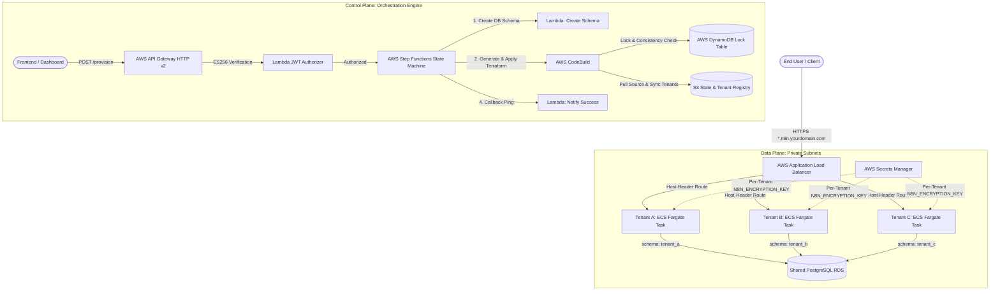

<div align="center">

# 🚀 TryBase

### The Open-Source Multi-Tenant, Multi-Cloud Orchestrator for AI Agents & Workflows

[](https://opensource.org/licenses/Apache-2.0)
[](https://www.terraform.io/)
[](#-roadmap-the-path-to-workload-adapters)
[](#-curated-workload-adapters)
[](#-isolated-vector-memory-pgvector)
[](CONTRIBUTING.md)

**Deploy, orchestrate, and scale an isolated fleet of production-grade AI Agent studios (Dify, n8n, Langflow) and autonomous workloads across clouds.**  
Built for agencies, AI automation studios, and enterprise platforms who need strict client data isolation, dedicated microVM compute, and isolated vector memory (`pgvector`) for ~$4–$5/tenant/month without paying $50+/seat SaaS fees or maintaining Kubernetes.

[Features](#-key-features) • [Architecture](#-architecture) • [AI Workload Adapters](#-curated-workload-adapters) • [Cost Breakdown](#-cost-breakdown) • [Why Not Kubernetes?](#-why-trybase-instead-of-kubernetes-eks) • [Quickstart](#-quickstart-guide) • [License](#-license--disclaimer)

---

</div>

## 💡 Why TryBase?

Hosting a single AI agent or n8n workflow on a VPS with Docker Compose is easy. But the moment you need to serve **10, 20, or 100 enterprise clients** or departments, you hit the multi-tenant AI wall:
- **Commercial SaaS Platforms** (Dify Cloud, n8n Cloud) charge **$50–$200/seat/month**, destroying agency profit margins at scale.
- **A Single Shared Server** creates catastrophic security risks: shared memory, API key cross-contamination, and runaway tool scripts taking down all clients.
- **Kubernetes (EKS)** requires a dedicated SRE team, complex ingress controllers, and a minimum **$150–$250/month baseline fee** before running a single tenant.
- **Separate Virtual Machines / RDS per Tenant** creates massive infrastructure bloat, complex patching, and crippling cloud bills.

**TryBase solves this with the optimal cost-to-isolation pattern:**  
Hardware-level microVM container isolation on **AWS ECS Fargate**, database and vector isolation on a shared **Graviton RDS PostgreSQL (`pgvector`)** cluster, and instant API orchestration via **AWS Step Functions & CodeBuild**.

| Feature | Single Docker VPS | Managed AI SaaS | Kubernetes (EKS) | TryBase |
| :--- | :---: | :---: | :---: | :---: |
| **Compute Isolation** | ❌ Shared Process | ✅ Isolated | ⚠️ Shared Kernel | ✅ **Dedicated Firecracker MicroVM** |
| **Database & Vector Memory** | ❌ Shared Tables | ✅ Isolated | ❌ Unmanaged Pods | ✅ **Dedicated RDS Schema/DB with `pgvector`** |
| **Subdomain Routing** | ❌ Manual Nginx | ✅ Automated | ⚠️ Complex Ingress | ✅ **Automated Host-Header ALB Routing** |
| **LLM Key Security** | ❌ Shared Env | ✅ Managed | ⚠️ Complex Secrets | ✅ **Unique AES-256 Vault per Tenant** |
| **Base Platform Cost** | ~$20/mo (No isolation) | N/A ($50+/seat) | ~$150–$250/mo | **~$50–$65/mo (Fleet-wide)** |
| **Cost for 20 Tenants** | ~$40/mo (Insecure) | ~$1,000–$4,000/mo | ~$350+/mo | **~$120–$140/mo (Full isolation)** |

---

## 🏗️ Architecture



### 1. Dedicated Compute (ECS Fargate)
Every tenant receives their own dedicated AWS Fargate task running n8n. Tasks run inside private subnets without public IPs. If one tenant runs an infinite loop or heavy memory workload, no other tenant is impacted.

### 2. Schema-Scoping Engine (RDS PostgreSQL)
Rather than paying for 20 separate database instances, TryBase uses a shared RDS PostgreSQL instance (Graviton 2) with **dedicated database schemas** (`CREATE SCHEMA tenant_slug`). The custom container Lambda automatically validates and provisions schemas with hyphen-to-underscore sanitization before containers start.

### 3. Dynamic Subdomain Routing (Application Load Balancer)
A shared ALB handles TLS termination via AWS Certificate Manager (ACM). When a tenant is provisioned, CodeBuild attaches a listener rule matching the tenant's host header (e.g. `client-a.n8n.yourdomain.com`) forwarding directly to that tenant's target group.

### 4. Zero-Knowledge Credential Security
n8n uses `N8N_ENCRYPTION_KEY` to encrypt API keys and credentials in its database. TryBase mints a unique 32-character AES-256 key per tenant inside AWS Secrets Manager. Even on a shared database, one tenant cannot decrypt another tenant's credentials.

### 5. Serverless Provisioning Pipeline
- **API Gateway**: REST endpoint with custom ES256 JWT authorizer for Supabase / custom auth tokens.
- **Step Functions**: 4-step state machine orchestrating schema generation, dynamic CodeBuild Terraform application, and callback notification.
- **S3 State & Tenant Registry**: CodeBuild automatically syncs `tenant_<slug>.tf` configurations, stores the Terraform remote state (`shared/terraform.tfstate`), and pulls the infrastructure source archive (`source/infra.zip`).
- **DynamoDB State Lock Table**: Manages distributed state locks and MD5 cryptographic integrity for Terraform (`n8n-hosting-saas-tf-locks`). Prevents race conditions and state corruption when multiple tenants are provisioned concurrently by CodeBuild or when local administrators run Terraform.

---

## 💰 Cost Breakdown

TryBase is designed to be lean. Below is an estimated real-world AWS cost breakdown (using standard pricing in `us-east-1` / `eu-west-2`):

### Shared Platform Base (Fixed)
| Resource | Spec | Est. Monthly Cost |
| :--- | :--- | :--- |
| **AWS RDS PostgreSQL** | `db.t4g.micro` (ARM64, 20GB GP2) | ~$15.00 |
| **Application Load Balancer** | 1 ALB with SSL termination | ~$18.00–$22.00 |
| **VPC Endpoints & Networking** | S3 Gateway + Secrets Manager Endpoints | ~$15.00–$25.00 |
| **API Gateway & Step Functions** | Serverless (Pay-per-request) | < $1.00 |
| **DynamoDB (State Locking)** | On-Demand (`PAY_PER_REQUEST`, state locks only) | $0.00 |
| **Total Base Cost** | **Shared Cluster Foundation** | **~$50–$65 / month** |

### Per-Tenant Cost (Variable)
| Resource | Allocation | Est. Monthly Cost |
| :--- | :--- | :--- |
| **Fargate Task** | 0.5 vCPU / 1.0 GB RAM (24/7 runtime) | ~$3.50–$4.50 / month |
| **Secrets Manager** | 1 Encryption Key secret | ~$0.40 / month |
| **Total Per Active Tenant** | | **~$4.00–$5.00 / month** |

> 💡 **Fleet Economics**: 20 fully isolated, dedicated enterprise n8n tenants cost approximately **~$130–$150/month total** on AWS, compared to **$1,000+/month** on managed SaaS platforms.

---

## ⚖️ Why TryBase Instead of Kubernetes (EKS)?

A common question from cloud architects is: *"Why not deploy this on Kubernetes (EKS) with Helm?"*

While Kubernetes is powerful for microservice meshes, running multi-tenant isolated workloads like n8n on Kubernetes introduces substantial cost, complexity, and security trade-offs:

| Dimension | Kubernetes (AWS EKS) | TryBase (AWS ECS Fargate) |
| :--- | :--- | :--- |
| **Minimum Base Cost** | **~$150–$250 / month** ($73/mo EKS cluster fee + redundant EC2 worker nodes) | **~$50 / month** (ALB + Graviton RDS; Fargate has zero cluster fee) |
| **Maintenance Overhead** | **High** (Mandatory yearly k8s version upgrades, deprecated APIs, node patching, CNI upgrades, Helm charts) | **Zero** (Serverless AWS managed runtime; no nodes, no OS, no cluster to patch) |
| **Container Isolation** | **Shared Linux Kernel** (Pods share nodes; vulnerable to noisy neighbors and kernel exploits) | **Firecracker MicroVM** (Every tenant task runs in a dedicated hardware hypervisor) |
| **DevOps Footprint** | **Requires Dedicated SRE** (Ingress-NGINX, Cert-Manager, Karpenter, Pod Disruption Budgets) | **Developer-Friendly** (2 CLI commands: `make control-plane` and `make infra`) |
| **Database Multi-Tenancy** | **Unsolved** (Requires custom operators or 20 separate unmanaged Postgres pods) | **Built-in** (Automated Postgres schema engine + AWS Secrets Manager) |

### Key Architectural Rationale

1. **Zero "Cluster Tax"**: In AWS, just keeping an EKS control plane alive costs **$73.00/month** before deploying a single pod. Add two worker nodes for high availability, and your minimum baseline is ~$150+/month even with zero users. TryBase uses **ECS Fargate**, which has **$0.00 cluster fees**—you only pay for active container seconds.
2. **True Hardware Isolation (MicroVMs)**: In standard Kubernetes, pods share the worker node's host kernel. If Tenant A runs a runaway workflow or encounters a memory leak, it can starve or crash the node, impacting Tenant B. With AWS Fargate, each tenant container runs inside its own **AWS Firecracker MicroVM** with hardware-level boundary isolation.
3. **No Kubernetes Upgrade Treadmill**: Kubernetes forces major version upgrades every ~12 months, which routinely break Ingress resources, CRDs, and CNI plugins. TryBase relies entirely on managed serverless building blocks (Fargate, Step Functions, RDS), meaning zero node management, zero AMI patching, and zero operational toil.
4. **The Database Problem**: Kubernetes only orchestrates containers—it does not solve data isolation. TryBase provides the automated database schema provisioning pipeline (`CREATE SCHEMA tenant_slug`) on a single high-performance Graviton RDS instance, achieving strict isolation at 90% lower cost.

---

## 🚀 Quickstart Guide

### Prerequisites
- [AWS CLI v2](https://docs.aws.amazon.com/cli/latest/userguide/install-cliv2.html) installed and configured (`aws configure`).
- [Terraform](https://developer.hashicorp.com/terraform/downloads) >= 1.8.0.
- [Docker](https://www.docker.com/) running locally (for initial Lambda image push).
- A domain with a **Wildcard SSL Certificate** in AWS Certificate Manager (e.g. `*.n8n.yourdomain.com`).

## ⚡ Deploy in 2 Commands

TryBase is engineered for maximum developer velocity. Bootstrapping the entire multi-tenant platform (Supabase Control Plane + AWS Fleet Infrastructure) takes just **2 CLI commands**:

```bash
git clone https://github.com/your-username/trybase.git
cd trybase
```

### 1️⃣ Command 1: Deploy the Control Plane (Supabase)
```bash
./deploy-control-plane.sh
# or: make control-plane
```
**What this does automatically:**
- Links to your Supabase project (prompts for your Project Ref if needed).
- Pushes database migrations (creates `workspaces` table with Row-Level Security).
- Deploys the 3 Edge Functions (`on-provision-success`, `verify-checkout`, `create-portal-session`).
- Automatically updates `terraform/terraform.tfvars` with your Supabase URL and settings.

---

### 2️⃣ Command 2: Deploy the Fleet Infrastructure (AWS)
```bash
./deploy-infra.sh
# or: make infra
```
**What this does automatically:**
- Verifies your AWS credentials and Terraform installation.
- Initializes Terraform and provisions the shared VPC, private subnets, Graviton RDS PostgreSQL database, Application Load Balancer, Step Functions state machine, and CodeBuild executors.
- Outputs the **ALB DNS Name** and **API Gateway Provisioning Endpoint**.

---

### 3️⃣ Point Your Wildcard Domain (Final Step)
Once `./deploy-infra.sh` finishes, it outputs `alb_dns_name`:
```text
alb_dns_name = "n8n-hosting-shared-alb-123456789.eu-west-2.elb.amazonaws.com"
```
In your DNS provider (Hostinger, Cloudflare, GoDaddy, Namecheap):
Add a single **Wildcard CNAME**:
| Record Type | Host / Name | Target / Points To |
| :--- | :--- | :--- |
| **CNAME** | `*.n8n` *(or `*` if using apex)* | `<alb_dns_name>` |

---

### 4️⃣ Launch the Web Dashboard (UI)
```bash
make web
```
Spins up the integrated React/Vite dashboard locally with interactive provisioning, real-time terminal logs, and multi-engine selection (n8n Automation & Dify AI Studio).

🎉 **That's it!** Your entire platform is live. You can immediately provision tenants via the UI, API, or GitOps.

---

## 👥 Provisioning Tenants

You can provision tenants in two ways: **Automated via API** or **Declarative via GitOps**.

### Option A: Automated via API (Recommended for Platforms & Dashboards)
Send an authenticated `POST` request to your API Gateway endpoint:

```bash
curl -X POST "https://<API_GATEWAY_URL>/provision" \
  -H "Authorization: Bearer <JWT_TOKEN>" \
  -H "Content-Type: application/json" \
  -d '{
    "tenant_id": "acme-corp",
    "subdomain": "acme",
    "rule_priority": 100
  }'
```

**What happens behind the scenes:**
1. API Gateway validates the JWT with the ES256 Lambda Authorizer.
2. Step Functions triggers the `n8n-tenant-create-schema` Lambda to create Postgres schema `acme_corp`.
3. CodeBuild pulls the Terraform source archive from S3, generates `tenant_acme-corp.tf`, and runs `terraform apply -target=module.acme_corp`.
4. The ALB automatically begins routing `https://acme.n8n.yourdomain.com` to the new Fargate container.

---

### Option B: Declarative via GitOps
If you prefer managing tenants statically in Git without the API:

1. Copy the tenant example file:
   ```bash
   cp tenant_example.tf.example tenant_acme.tf
   ```
2. Edit `tenant_acme.tf` with your tenant slug and unique ALB priority:
   ```hcl
   module "acme" {
     source    = "./modules/tenant"
     tenant_id = "acme"
     subdomain = "acme"
     db_schema = "acme"
     
     alb_listener_rule_priority = 100
     # (Shared variables mapped from shared infrastructure)
   }
   ```
3. Apply the tenant:
   ```bash
   terraform apply -target=module.acme
   ```

---

### Option C: Generic Container ("Hello World")
TryBase isn't locked to n8n! Its core orchestration brain can run **any arbitrary container** with private Fargate isolation, custom environment variables, and automated subdomain routing on the shared ALB.

To deploy a lightweight generic "Hello World" service:
1. Copy the generic workload template:
   ```bash
   cp tenant_hello_world.tf.example tenant_hello.tf
   ```
2. Inspect `tenant_hello.tf`:
   ```hcl
   module "hello_world" {
     source = "./modules/generic-workload"

     service_name    = "hello-world"
     subdomain       = "hello"
     container_image = "nginxdemos/hello:plain-text"
     container_port  = 80
     health_check_path = "/"

     environment_variables = {
       WELCOME_MESSAGE = "Hello from TryBase Generic Container!"
     }

     # Bind to TryBase shared infrastructure
     vpc_id                     = module.vpc.vpc_id
     private_subnet_ids         = module.vpc.private_subnets
     ecs_cluster_name           = aws_ecs_cluster.main.name
     alb_listener_arn           = aws_lb_listener.https.arn
     alb_security_group_id      = aws_security_group.alb.id
     alb_listener_rule_priority = 200
     domain_name                = var.base_domain
   }
   ```
3. Deploy it in seconds:
   ```bash
   terraform apply -target=module.hello_world
   ```
4. Visit `https://hello.<your-base-domain>` — your service is live behind TLS and isolated in private subnets!

---

## 🛠️ Repository Structure

```text
trybase/
├── terraform/
│   ├── main.tf                    # Provider configuration & data sources
│   ├── variables.tf               # Configurable parameters & defaults
│   ├── terraform.tfvars.example   # Example configuration template
│   ├── outputs.tf                 # ALB DNS, API Gateway URL, Step Function ARNs
│   ├── vpc.tf                     # 3-tier VPC with public/private subnets
│   ├── alb.tf                     # Application Load Balancer & HTTPS redirect
│   ├── rds.tf                     # Shared Graviton RDS PostgreSQL instance
│   ├── ecs.tf                     # ECS Cluster definition
│   ├── apigateway.tf              # HTTP v2 API & CORS configuration
│   ├── authorizer.tf              # ES256 Supabase JWT Lambda Authorizer
│   ├── stepfunctions.tf           # Orchestration state machine
│   ├── codebuild.tf               # Terraform executor for dynamic tenant provisioning
│   ├── bastion.tf                 # Secure jump host for private database administration
│   ├── tenant_example.tf.example  # Declarative GitOps tenant template
│   └── modules/
│       └── tenant/                # Reusable tenant module (Fargate task, target group, rules)
├── lambda/
│   ├── authorizer/                # Lightweight Node.js ES256 JWT verifier
│   └── create-schema/             # Python RDS schema provisioning container
├── sync-tenants.sh                # Synchronizes dynamic tenant configs from S3 to local Git
├── cleanup-enis.sh                # Helper script to clean up orphaned Lambda ENIs
├── BOOTSTRAP.md                   # Operational guide & bootstrap gotchas
├── ARCHITECTURE.md                # Comprehensive technical specification
└── LICENSE                        # Apache 2.0 License
```

---

## 🤝 Operational Workflows

### Keeping Local State in Sync with Cloud Tenants
When tenants are provisioned via API, CodeBuild saves their configuration files in the S3 state bucket. Before running local Terraform commands, always sync your local directory:
```bash
./sync-tenants.sh
```

### Accessing the Database via Bastion
To inspect tenant schemas or debug workflows:
```bash
# 1. Retrieve master credentials
aws secretsmanager get-secret-value --secret-id $(terraform -chdir=terraform output -raw db_credentials_secret_arn) --query SecretString --output text

# 2. Connect through the Bastion jump host
ssh -i ~/.ssh/your-key.pem ec2-user@<BASTION_IP>

# 3. Inside the bastion, connect to PostgreSQL
PGPASSWORD='<PASSWORD>' PGSSLMODE=require psql -h <DB_HOSTNAME> -U n8nmaster -d postgres
```

### Forecasting Cloud Costs with Infracost
TryBase integrates with [Infracost](https://www.infracost.io/) (Apache 2.0) to forecast monthly AWS and multi-cloud fleet expenses before applying changes:
```bash
make cost
```

---

## 🗺️ Roadmap: The Path to Workload Adapters

TryBase is evolving from an n8n orchestrator into a universal multi-tenant platform for self-hosted apps and AI workflows:

### 1. Workload Adapter Evolution
- [x] **Flagship n8n Workload**: Production-hardened with Postgres schema scoping, unique encryption keys, and Resend SMTP.
- [x] **Generic Container Module** (`modules/generic-workload`): Deploy any arbitrary Docker container (APIs, microservices, hello-world) with private Fargate isolation and ALB host routing.
- [x] **Multi-Database & `pgvector` Provisioning**: RDS Lambda dual-mode orchestrator supporting *Schema-per-tenant* (`CREATE SCHEMA`) and *Database-per-tenant* (`CREATE DATABASE`) with native `vector` extension setup.
- [x] **Integrated Web Monorepo (`web/` & `make web`)**: Vite/React dashboard with AI Engine selection (n8n vs Dify), real-time Step Function terminal logs, and customer self-service.
- [ ] **Curated Workload Adapters**:
  - **Dify**: Enterprise self-hosted LLM application and multi-agent platform with native `pgvector` memory (adapter template in `terraform/tenant_dify.tf.example`).
  - **Langflow**: Multi-agent visual workflow orchestrator.
  - **Activepieces**: Lightweight open-source automation runner.

### 2. Platform Capabilities
- [x] **Infracost Integration (`make cost`)**: Forecast exact monthly infrastructure and tenant costs via open-source Infracost.
- [ ] **Container Auto-Idling**: Automatically scale down inactive tenant Fargate tasks to 0 and wake on incoming HTTP webhooks (drastically reducing idle compute bills).
- [ ] **Custom Domain Support**: Allow tenants to bring their own apex domains via CNAME with automated ACM SSL issuance.
- [ ] **Stripe Usage Billing**: Meter execution events and sync billing overages to Stripe subscriptions.
- [ ] **AI Assistant Gateway**: Centralized proxy for tenant OpenAI/Anthropic credentials and token metering.

---

## 📄 License & Disclaimer

### License
This project is licensed under the **Apache License 2.0** - see the [LICENSE](LICENSE) file for details.

### Disclaimer & n8n Fair-Code Notice
- **TryBase** is an independent, community-driven open-source project and is not affiliated with, endorsed by, or sponsored by n8n GmbH.
- `n8n` is a registered trademark of n8n GmbH.
- n8n software is distributed under its Fair-Code [Sustainable Use License](https://n8n.io/legal/sustainable-use-license). While this repository provides infrastructure code for self-hosting n8n instances, anyone intending to offer n8n as a commercial SaaS service to third parties should consult n8n GmbH regarding their commercial licensing terms.
