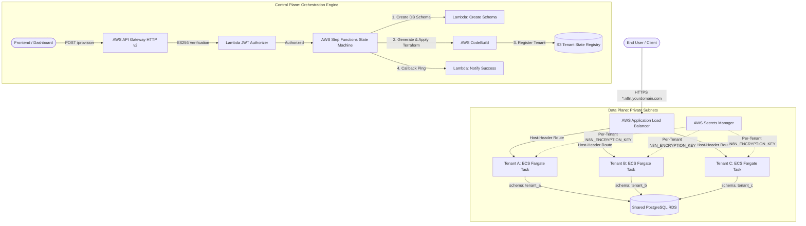

<div align="center">

# 🚀 TryBase

### The Open-Source Multi-Tenant n8n Cloud Orchestrator on AWS

[](https://opensource.org/licenses/Apache-2.0)
[](https://www.terraform.io/)
[](https://aws.amazon.com/)
[](https://n8n.io/)
[](CONTRIBUTING.md)

**Deploy, orchestrate, and manage an isolated fleet of production-grade n8n instances on AWS.**  
Built for agencies, platforms, and internal engineering teams who need secure multi-tenancy without paying per-seat SaaS costs or managing fragile virtual machines.

[Features](#-key-features) • [Architecture](#-architecture) • [Cost Breakdown](#-cost-breakdown) • [Quickstart](#-quickstart-guide) • [Tenant Provisioning](#-provisioning-tenants) • [License](#-license--disclaimer)

---

</div>

## 💡 Why TryBase?

Running a single n8n instance on a VPS with Docker Compose is straightforward. But the moment you need to host **10, 20, or 50 isolated instances** for clients, departments, or users, you face a dilemma:
- **n8n Cloud** becomes prohibitively expensive at scale ($50+/month per instance).
- **A Single Shared n8n Instance** poses extreme security risks: shared memory, shared credentials, and execution bleed between tenants.
- **A Separate Virtual Machine / RDS per Tenant** creates massive infrastructure bloat, complex patching, and high AWS bills.

**TryBase solves this with the optimal cost-to-isolation pattern:**  
Process-level container isolation on **AWS ECS Fargate**, database-level schema isolation on a shared **PostgreSQL RDS (Graviton)** cluster, and automated orchestration via **AWS Step Functions & CodeBuild**.

| Feature | Single Docker VM | n8n Cloud | TryBase |
| :--- | :---: | :---: | :---: |
| **Compute Isolation** | ❌ Shared Process | ✅ Isolated | ✅ **Dedicated Fargate Container** |
| **Database Isolation** | ❌ Shared Tables | ✅ Isolated | ✅ **Isolated PostgreSQL Schema** |
| **Dynamic Subdomains** | ❌ Manual Nginx | ✅ Automated | ✅ **Automated Host-Header Routing** |
| **Credentials Encryption** | ❌ Single Key | ✅ Managed | ✅ **Unique AES-256 Key per Tenant** |
| **API Provisioning** | ❌ Manual SSH | ❌ Dashboard only | ✅ **Serverless Step Function API** |
| **Cost for 20 Tenants** | ~$40/mo (No isolation) | ~$1,000+/mo | **~$110–$140/mo (Full isolation)** |

---

## 🏗️ Architecture



### 1. Dedicated Compute (ECS Fargate)
Every tenant receives their own dedicated AWS Fargate task running n8n. Tasks run inside private subnets without public IPs. If one tenant runs an infinite loop or heavy memory workload, no other tenant is impacted.

### 2. Schema-Scoping Engine (RDS PostgreSQL)
Rather than paying for 20 separate database instances, TryBase uses a shared RDS PostgreSQL instance (Graviton 2) with **dedicated database schemas** (`CREATE SCHEMA tenant_slug`). The custom container Lambda automatically validates and provisions schemas with hyphen-to-underscore sanitization before containers start.

### 3. Dynamic Subdomain Routing (Application Load Balancer)
A shared ALB handles TLS termination via AWS Certificate Manager (ACM). When a tenant is provisioned, CodeBuild attaches a listener rule matching the tenant's host header (e.g. `client-a.n8n.yourdomain.com`) forwarding directly to that tenant's target group.

### 4. Zero-Knowledge Credential Security
n8n uses `N8N_ENCRYPTION_KEY` to encrypt API keys and credentials in its database. TryBase mints a unique 32-character AES-256 key per tenant inside AWS Secrets Manager. Even on a shared database, one tenant cannot decrypt another tenant's credentials.

### 5. Serverless Provisioning Pipeline
- **API Gateway**: REST endpoint with custom ES256 JWT authorizer for Supabase / custom auth tokens.
- **Step Functions**: 4-step state machine orchestrating schema generation, dynamic CodeBuild Terraform application, and callback notification.
- **S3 Tenant Registry**: CodeBuild automatically syncs `tenant_<slug>.tf` configurations to S3, ensuring full state reconciliation across deployments.

---

## 💰 Cost Breakdown

TryBase is designed to be lean. Below is an estimated real-world AWS cost breakdown (using standard pricing in `us-east-1` / `eu-west-2`):

### Shared Platform Base (Fixed)
| Resource | Spec | Est. Monthly Cost |
| :--- | :--- | :--- |
| **AWS RDS PostgreSQL** | `db.t4g.micro` (ARM64, 20GB GP2) | ~$15.00 |
| **Application Load Balancer** | 1 ALB with SSL termination | ~$18.00–$22.00 |
| **VPC Endpoints & Networking** | S3 Gateway + Secrets Manager Endpoints | ~$15.00–$25.00 |
| **API Gateway & Step Functions** | Serverless (Pay-per-request) | < $1.00 |
| **Total Base Cost** | **Shared Cluster Foundation** | **~$50–$65 / month** |

### Per-Tenant Cost (Variable)
| Resource | Allocation | Est. Monthly Cost |
| :--- | :--- | :--- |
| **Fargate Task** | 0.5 vCPU / 1.0 GB RAM (24/7 runtime) | ~$3.50–$4.50 / month |
| **Secrets Manager** | 1 Encryption Key secret | ~$0.40 / month |
| **Total Per Active Tenant** | | **~$4.00–$5.00 / month** |

> 💡 **Fleet Economics**: 20 fully isolated, dedicated enterprise n8n tenants cost approximately **~$130–$150/month total** on AWS, compared to **$1,000+/month** on managed SaaS platforms.

---

## 🚀 Quickstart Guide

### Prerequisites
- [AWS CLI v2](https://docs.aws.amazon.com/cli/latest/userguide/install-cliv2.html) installed and configured (`aws configure`).
- [Terraform](https://developer.hashicorp.com/terraform/downloads) >= 1.8.0.
- [Docker](https://www.docker.com/) running locally (for initial Lambda image push).
- A domain with a **Wildcard SSL Certificate** in AWS Certificate Manager (e.g. `*.n8n.yourdomain.com`).

## ⚡ Deploy in 2 Commands

TryBase is engineered for maximum developer velocity. Bootstrapping the entire multi-tenant platform (Supabase Control Plane + AWS Fleet Infrastructure) takes just **2 CLI commands**:

```bash
git clone https://github.com/your-username/trybase.git
cd trybase
```

### 1️⃣ Command 1: Deploy the Control Plane (Supabase)
```bash
./deploy-control-plane.sh
# or: make control-plane
```
**What this does automatically:**
- Links to your Supabase project (prompts for your Project Ref if needed).
- Pushes database migrations (creates `workspaces` table with Row-Level Security).
- Deploys the 3 Edge Functions (`on-provision-success`, `verify-checkout`, `create-portal-session`).
- Automatically updates `terraform/terraform.tfvars` with your Supabase URL and settings.

---

### 2️⃣ Command 2: Deploy the Fleet Infrastructure (AWS)
```bash
./deploy-infra.sh
# or: make infra
```
**What this does automatically:**
- Verifies your AWS credentials and Terraform installation.
- Initializes Terraform and provisions the shared VPC, private subnets, Graviton RDS PostgreSQL database, Application Load Balancer, Step Functions state machine, and CodeBuild executors.
- Outputs the **ALB DNS Name** and **API Gateway Provisioning Endpoint**.

---

### 3️⃣ Point Your Wildcard Domain (Final Step)
Once `./deploy-infra.sh` finishes, it outputs `alb_dns_name`:
```text
alb_dns_name = "n8n-hosting-shared-alb-123456789.eu-west-2.elb.amazonaws.com"
```
In your DNS provider (Hostinger, Cloudflare, GoDaddy, Namecheap):
Add a single **Wildcard CNAME**:
| Record Type | Host / Name | Target / Points To |
| :--- | :--- | :--- |
| **CNAME** | `*.n8n` *(or `*` if using apex)* | `<alb_dns_name>` |

🎉 **That's it!** Your entire platform is live. You can immediately provision tenants via the API or GitOps.

---

## 👥 Provisioning Tenants

You can provision tenants in two ways: **Automated via API** or **Declarative via GitOps**.

### Option A: Automated via API (Recommended for Platforms & Dashboards)
Send an authenticated `POST` request to your API Gateway endpoint:

```bash
curl -X POST "https://<API_GATEWAY_URL>/provision" \
  -H "Authorization: Bearer <JWT_TOKEN>" \
  -H "Content-Type: application/json" \
  -d '{
    "tenant_id": "acme-corp",
    "subdomain": "acme",
    "rule_priority": 100
  }'
```

**What happens behind the scenes:**
1. API Gateway validates the JWT with the ES256 Lambda Authorizer.
2. Step Functions triggers the `n8n-tenant-create-schema` Lambda to create Postgres schema `acme_corp`.
3. CodeBuild clones the repo, generates `tenant_acme-corp.tf`, and runs `terraform apply -target=module.acme_corp`.
4. The ALB automatically begins routing `https://acme.n8n.yourdomain.com` to the new Fargate container.

---

### Option B: Declarative via GitOps
If you prefer managing tenants statically in Git without the API:

1. Copy the tenant example file:
   ```bash
   cp tenant_example.tf.example tenant_acme.tf
   ```
2. Edit `tenant_acme.tf` with your tenant slug and unique ALB priority:
   ```hcl
   module "acme" {
     source    = "./modules/tenant"
     tenant_id = "acme"
     subdomain = "acme"
     db_schema = "acme"
     
     alb_listener_rule_priority = 100
     # (Shared variables mapped from shared infrastructure)
   }
   ```
3. Apply the tenant:
   ```bash
   terraform apply -target=module.acme
   ```

---

### Option C: Generic Container ("Hello World")
TryBase isn't locked to n8n! Its core orchestration brain can run **any arbitrary container** with private Fargate isolation, custom environment variables, and automated subdomain routing on the shared ALB.

To deploy a lightweight generic "Hello World" service:
1. Copy the generic workload template:
   ```bash
   cp tenant_hello_world.tf.example tenant_hello.tf
   ```
2. Inspect `tenant_hello.tf`:
   ```hcl
   module "hello_world" {
     source = "./modules/generic-workload"

     service_name    = "hello-world"
     subdomain       = "hello"
     container_image = "nginxdemos/hello:plain-text"
     container_port  = 80
     health_check_path = "/"

     environment_variables = {
       WELCOME_MESSAGE = "Hello from TryBase Generic Container!"
     }

     # Bind to TryBase shared infrastructure
     vpc_id                     = module.vpc.vpc_id
     private_subnet_ids         = module.vpc.private_subnets
     ecs_cluster_name           = aws_ecs_cluster.main.name
     alb_listener_arn           = aws_lb_listener.https.arn
     alb_security_group_id      = aws_security_group.alb.id
     alb_listener_rule_priority = 200
     domain_name                = var.base_domain
   }
   ```
3. Deploy it in seconds:
   ```bash
   terraform apply -target=module.hello_world
   ```
4. Visit `https://hello.<your-base-domain>` — your service is live behind TLS and isolated in private subnets!

---

## 🛠️ Repository Structure

```text
trybase/
├── terraform/
│   ├── main.tf                    # Provider configuration & data sources
│   ├── variables.tf               # Configurable parameters & defaults
│   ├── terraform.tfvars.example   # Example configuration template
│   ├── outputs.tf                 # ALB DNS, API Gateway URL, Step Function ARNs
│   ├── vpc.tf                     # 3-tier VPC with public/private subnets
│   ├── alb.tf                     # Application Load Balancer & HTTPS redirect
│   ├── rds.tf                     # Shared Graviton RDS PostgreSQL instance
│   ├── ecs.tf                     # ECS Cluster definition
│   ├── apigateway.tf              # HTTP v2 API & CORS configuration
│   ├── authorizer.tf              # ES256 Supabase JWT Lambda Authorizer
│   ├── stepfunctions.tf           # Orchestration state machine
│   ├── codebuild.tf               # Terraform executor for dynamic tenant provisioning
│   ├── bastion.tf                 # Secure jump host for private database administration
│   ├── tenant_example.tf.example  # Declarative GitOps tenant template
│   └── modules/
│       └── tenant/                # Reusable tenant module (Fargate task, target group, rules)
├── lambda/
│   ├── authorizer/                # Lightweight Node.js ES256 JWT verifier
│   └── create-schema/             # Python RDS schema provisioning container
├── sync-tenants.sh                # Synchronizes dynamic tenant configs from S3 to local Git
├── cleanup-enis.sh                # Helper script to clean up orphaned Lambda ENIs
├── BOOTSTRAP.md                   # Operational guide & bootstrap gotchas
├── ARCHITECTURE.md                # Comprehensive technical specification
└── LICENSE                        # Apache 2.0 License
```

---

## 🤝 Operational Workflows

### Keeping Local State in Sync with Cloud Tenants
When tenants are provisioned via API, CodeBuild saves their configuration files in the S3 state bucket. Before running local Terraform commands, always sync your local directory:
```bash
./sync-tenants.sh
```

### Accessing the Database via Bastion
To inspect tenant schemas or debug workflows:
```bash
# 1. Retrieve master credentials
aws secretsmanager get-secret-value --secret-id $(terraform -chdir=terraform output -raw db_credentials_secret_arn) --query SecretString --output text

# 2. Connect through the Bastion jump host
ssh -i ~/.ssh/your-key.pem ec2-user@<BASTION_IP>

# 3. Inside the bastion, connect to PostgreSQL
PGPASSWORD='<PASSWORD>' PGSSLMODE=require psql -h <DB_HOSTNAME> -U n8nmaster -d postgres
```

---

## 🗺️ Roadmap: The Path to Workload Adapters

TryBase is evolving from an n8n orchestrator into a universal multi-tenant platform for self-hosted apps and AI workflows:

### 1. Workload Adapter Evolution
- [x] **Flagship n8n Workload**: Production-hardened with Postgres schema scoping, unique encryption keys, and Resend SMTP.
- [x] **Generic Container Module** (`modules/generic-workload`): Deploy any arbitrary Docker container (APIs, microservices, hello-world) with private Fargate isolation and ALB host routing.
- [ ] **Multi-Database Provisioning**: Extend the DB Lambda to support both *Schema-per-tenant* (`CREATE SCHEMA`) and *Database-per-tenant* (`CREATE DATABASE`) for workloads requiring their own independent databases.
- [ ] **Curated Workload Adapters**:
  - **Flowise**: Multi-tenant LLM agents and LangChain flows with sandbox memory.
  - **Langflow**: Multi-agent visual workflow orchestrator.
  - **Dify**: Self-hosted LLM application platform.
  - **Activepieces**: Lightweight open-source automation runner.

### 2. Platform Capabilities
- [ ] **Container Auto-Idling**: Automatically scale down inactive tenant Fargate tasks to 0 and wake on incoming HTTP webhooks (drastically reducing idle compute bills).
- [ ] **Custom Domain Support**: Allow tenants to bring their own apex domains via CNAME with automated ACM SSL issuance.
- [ ] **Stripe Usage Billing**: Meter execution events and sync billing overages to Stripe subscriptions.
- [ ] **AI Assistant Gateway**: Centralized proxy for tenant OpenAI/Anthropic credentials and token metering.

---

## 📄 License & Disclaimer

### License
This project is licensed under the **Apache License 2.0** - see the [LICENSE](LICENSE) file for details.

### Disclaimer & n8n Fair-Code Notice
- **TryBase** is an independent, community-driven open-source project and is not affiliated with, endorsed by, or sponsored by n8n GmbH.
- `n8n` is a registered trademark of n8n GmbH.
- n8n software is distributed under its Fair-Code [Sustainable Use License](https://n8n.io/legal/sustainable-use-license). While this repository provides infrastructure code for self-hosting n8n instances, anyone intending to offer n8n as a commercial SaaS service to third parties should consult n8n GmbH regarding their commercial licensing terms.
